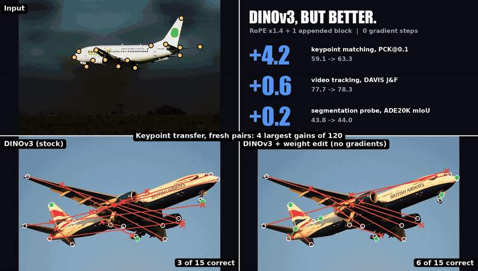
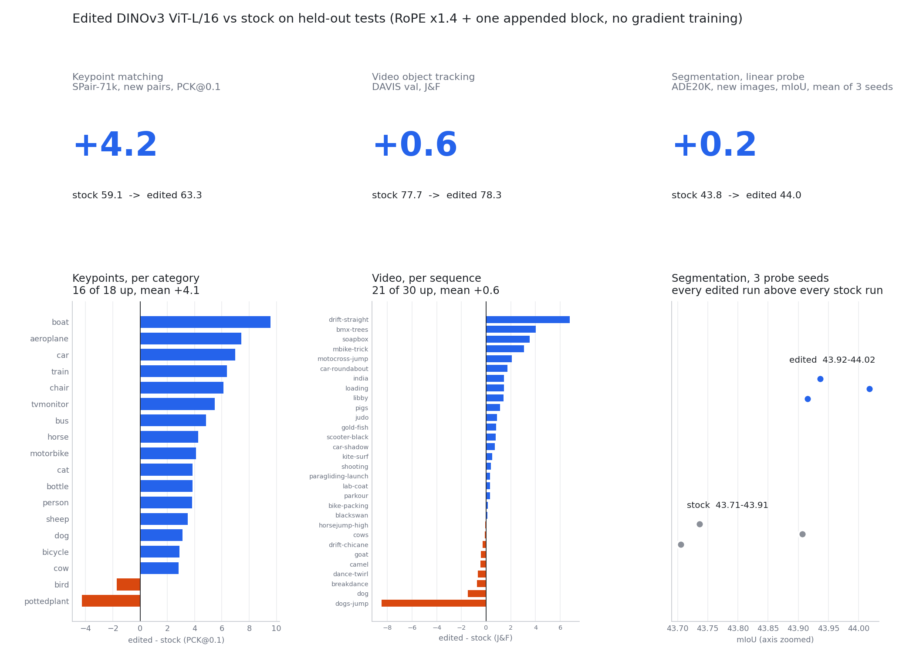
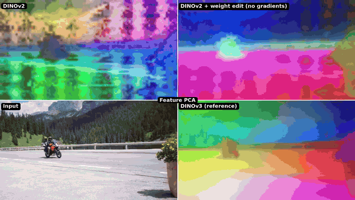
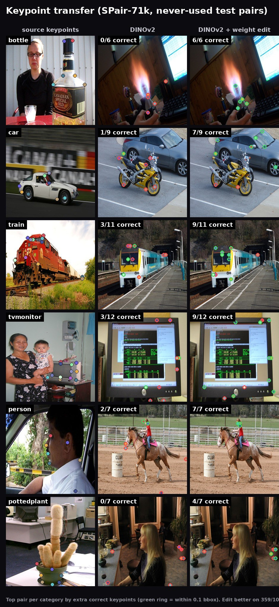

# DINOv2 / DINOv3 weight surgery

**Better dense features from DINOv2 ViT-L/14 and DINOv3 ViT-L/16 by editing their weights directly: no gradients,
no fine-tuning, no distillation.** Every changed number was written in closed form.

| Held-out test sets | DINOv3 ViT-L/16 | **DINOv3 + weight edit** |
|---|---|---|
| Keypoint transfer, SPair-71k PCK@0.1 | 59.1 | **63.3** |
| Video object segmentation, DAVIS-2017 val J&F | 77.7 | **78.3** |
| Semantic segmentation, ADE20K linear probe mIoU | 43.8 | **44.0** |

| Held-out test sets | DINOv2 ViT-L/14 | **DINOv2 + weight edit** | DINOv3 ViT-L/16 (reference) |
|---|---|---|---|
| Keypoint transfer, SPair-71k PCK@0.1 | 57.0 | **60.5** | 60.1 |
| Video object segmentation, DAVIS-2017 val J&F | 70.2 | **71.2** | 77.7 |
| Semantic segmentation, ADE20K linear probe mIoU | 39.5 | **41.7** | 44.9 |

The two tables use different fresh test draws of SPair-71k and ADE20K (each edit got its own draw that nothing had
touched), so the stock DINOv3 numbers differ between them. Read the [caveats](#caveats) before quoting these numbers.

<p align="center"><br>
<em>DINOv3, stock vs. edited: keypoint transfer on fresh SPair pairs (the 4 largest gains of a random 120-pair
subset). Full video with feature PCA, segmentation, tracking and video object segmentation:
<a href="assets/dinov3_demo.mp4">assets/dinov3_demo.mp4</a>.</em></p>

<p align="center"></p>

<p align="center"><br>
<em>DINOv2, stock vs. edited: feature PCA, semantic segmentation and video object segmentation. Full quality:
<a href="assets/demo.mp4">assets/demo.mp4</a>.</em></p>

## Use the edited models

**DINOv3 ViT-L/16.** Only the edit (`dinov3_vitl16_wsp_edit.pth`, 38 MB) is distributed here. It is applied on top
of the stock DINOv3 ViT-L/16 weights, which you get from Meta after accepting the
[DINOv3 License](https://github.com/facebookresearch/dinov3):

```python
import torch

model = torch.hub.load(
    "peasant98/dinov2-weight-surgery", "dinov3_vitl16_wsp",
    dinov3_weights="path/or/URL/dinov3_vitl16_pretrain_lvd1689m-8aa4cbdd.pth",
).cuda()

x = torch.randn(1, 3, 512, 512).cuda()            # ImageNet-normalized, sides are multiples of 16
feats = model.get_intermediate_layers(x, n=1, norm=True)[0]      # (1, 32 * 32, 1024) dense patch features
```

The result is a standard DINOv3 `DinoVisionTransformer` with 25 blocks instead of 24 and rescaled RoPE periods, so
it is a drop-in replacement wherever you read DINOv3-L patch features. The edit file is attached to the
[GitHub release](https://github.com/peasant98/dinov2-weight-surgery/releases) and downloads on first use; pass
`edit="path/to/dinov3_vitl16_wsp_edit.pth"` to use a local copy, and
`dinov3_repo="path/to/dinov3", dinov3_source="local"` to use a local clone of the DINOv3 code.

**DINOv2 ViT-L/14.**

```python
import torch

model = torch.hub.load("peasant98/dinov2-weight-surgery", "dinov2_vitl14_wsp").cuda()

x = torch.randn(1, 3, 448, 448).cuda()            # ImageNet-normalized, sides are multiples of 14
feats = model.get_intermediate_layers(x, n=1, norm=True)[0]      # (1, 32 * 32, 1024) dense patch features
```

The model is a standard DINOv2 `DinoVisionTransformer` with 25 blocks instead of 24 (one hand-written block is
appended), so it is a drop-in replacement wherever you read DINOv2-L patch features. The weights
(`dinov2_vitl14_wsp.pth`, 1.3 GB, a plain state dict) are attached to the
[GitHub release](https://github.com/peasant98/dinov2-weight-surgery/releases) and download on first use. To load a
local copy: `dinov2_wsp.dinov2_vitl14_wsp(weights="path/to/dinov2_vitl14_wsp.pth")`.

## What was edited

### DINOv3 ViT-L/16

Two edits, applied in this order (`research/build_v3.py` rebuilds them; the code is `research/wsp_v3.py`):

1. **RoPE coordinates scaled by 1.4** (the rotary periods divided by 1.4). DINOv3 was trained with random coordinate
   rescaling in [0.5, 2], so this stays inside what the model has seen. On its own it lowered the development
   video scores; together with edit 2 it raised the mean development gain from +2.49% to +2.61%.
2. **One appended block holding a pooled Fisher discriminant.** The block's attention is switched off and its MLP
   holds an exact linear map (`GELU(z) - GELU(-z) = z`), written in closed form from one generalized
   eigendecomposition. The two covariance matrices pool three problems, each normalized by the trace of its total
   scatter: matching SPair-71k *training* keypoints (weight 1), neighboring tokens across frames of DAVIS-2017
   *training* videos, same object vs. different object near object boundaries (weight 0.3), and semantic classes on
   1,000 ADE20K training images that are in no test draw (weight 0.3). Directions where matching tokens disagree are
   shrunk, consistent ones are boosted (beta 0.5).

### DINOv2 ViT-L/14

Four edits, applied in this order (`research/build.py` prints the exact chain):

1. **Damp "texture" MLP units.** DINOv2's dense features are speckled, and the speckle is written by MLP units in the
   later blocks. A unit is a texture unit if its activation differs between neighboring patches *inside* one object
   segment almost as much as *across* a segment boundary. Their outputs are pulled toward their mean (kept at 0.5 in
   blocks 7-16 and 0.3 in blocks 17-23). `research/texture_units.py`, `wsp_edits.mean_ablate_texture`.
2. **Switch off the MLP of the last block** (its LayerScale set to 0).
3. **A protected side channel and one appended block.** LayerNorm affines and LayerScales are folded into the
   neighboring linear layers (exact). The 19 channels whose removal costs the least are cut out of every read and
   write, and a Fourier code of the patch position is written into them through the position table. The appended
   block's attention reads only that code, so it is an exact local spatial kernel: each patch is blended with its
   neighbors. `research/side_channel.py`.
4. **A Fisher discriminant written into the appended block's MLP.** From SPair-71k *training* keypoint pairs we
   compute two covariance matrices (matching keypoints vs. all patches) and one generalized eigendecomposition.
   Directions where matching keypoints disagree are shrunk, consistent ones are boosted. Since
   `GELU(z) - GELU(-z) = z`, an MLP can hold an exact linear map, so the result is written straight into `fc1` and
   `fc2`. `research/linmap.py`.

<p align="center"></p>

## How edits were selected

Each round had a rule written down before any result of its candidates was seen (`research/selection_rules/`;
DINOv3: `SELECTION_RULE_v8.md`): candidates had to match or beat the stock model on development splits of all three
tasks (SPair-71k val, 12 DAVIS-2017 train videos, a COCO probe), the pick was the one with the largest mean relative
development gain, and the test splits in the tables were run once for the pick. The raw test outputs are in
`research/results/` (DINOv3: `dinov3_fresh11_*.json`, which also contain an earlier DINOv3 edit run alongside).

Things that did **not** work, so you can skip them. DINOv2: attention temperature, damping whole late blocks,
attention with keys in place of queries, stronger or repeated smoothing blocks (prettier feature maps, worse keypoints
and video segmentation), removing the positional subspace, and a Gram-matrix readout of an earlier block. DINOv3:
LayerScale gain and attention-sharpness edits in the late blocks, RoPE rescaling alone, similarity-weighted smoothing
of the output features, and a nonlinear block (fixed random GELU features with the discriminant fitted on top), which
scored lower on development keypoints and video than the linear block.

## Caveats

- **The keypoint tests are fair.** The Fisher edits are fit on SPair-71k *training* pairs (60 per category); the
  keypoint numbers are measured on separate test pairs that were never used to fit or select anything, like any
  method evaluated on SPair.
- **DINOv3 edit:** it is also fit on DAVIS-2017 *training* videos and ADE20K *training* images. The ADE20K test images
  are training images too (the probe needs labels), drawn so that they overlap neither the fit images nor any earlier
  draw. DAVIS val was never used to fit or select anything, but it had been used once before, to test an earlier
  DINOv3 edit. The video and segmentation gains are small: J&F is up on 21 of 30 DAVIS sequences, and the ADE20K
  number is the mean of 3 probe seeds (stock 43.71-43.91, edited 43.92-44.02).
- **DINOv2 edit:** DAVIS and ADE20K were never used to fit anything, and DINOv3 was never used to choose or fit it
  (it is only a reference row).
- **Only dense patch features were evaluated.** The class token and image-level tasks (k-NN / linear classification)
  were not tested and may be worse.
- **These are our own evaluation protocols, not official benchmark numbers:** zero-shot nearest-neighbor keypoint
  transfer on about 1,000 SPair test pairs, label propagation on DAVIS-2017 val, and a linear probe trained on a
  subset of ADE20K. They compare backbones under identical settings; they are not comparable to published tables.
- The DINOv2 gains are modest, and DINOv3 remains clearly better than edited DINOv2 on video and semantic
  segmentation.
- One extra block costs about 4% more compute. Run in fp32 or with bfloat16 autocast; fp16 was not tested.
- ViT-L without registers (DINOv2) and DINOv3 ViT-L/16 (LVD-1689M weights) only.

## Reproduce

`research/` is the code as it was run, lightly cleaned (it is research code, not a library).

```bash
export XFORMERS_DISABLED=1                 # optional, we ran without xformers
export WSP_DATA=/path/to/data              # coco/val2017, benchmarks/spair/SPair-71k, benchmarks/davis/DAVIS,
                                           # benchmarks/ade/ADEChallengeData2016
export WSP_DINOV3_REPO=/path/to/dinov3     # DINOv3 code and stock ViT-L/16 weights
export WSP_DINOV3_WEIGHTS=/path/to/dinov3_vitl16_pretrain_lvd1689m-8aa4cbdd.pth

# DINOv3
python research/build_v3.py                                       # rebuild the edit from stock DINOv3, compare to the release
cd research/downstream
MODELS=dinov3,wsp3 python spair.py out_spair.json test_fresh7     # keypoint transfer
MODELS=dinov3,wsp3 python davis.py out_davis.json 0 val           # video object segmentation
SEEDS=0,1,2 MODELS=wsp3 python ade_probe.py out_ade.json fresh4   # segmentation probe, one model per run (~18 GB RAM)
cd ../..

# DINOv2
export WSP_FIT_SCANS=my_images             # folders $WSP_DATA/<name>/images with ~24 natural images (calibration)
python research/build.py                                          # rebuild from stock DINOv2, compare to the release
cd research/downstream
MODELS=stock,wsp python spair.py out_spair.json test_fresh5       # keypoint transfer
MODELS=stock,wsp python davis.py out_davis.json 0 val             # video object segmentation
MODELS=stock,wsp python ade_probe.py out_ade.json fresh3          # semantic segmentation probe
```

DINOv3: the released edit loads bit-for-bit identical to the model that was tested, and the keypoint test run through
the released loader reproduces the table (PCK@0.1 0.6328). The DINOv3 edit is fit on public data only. A rebuild from scratch with
`build_v3.py` gave a patch-feature cosine of 0.99988 to the release, not bit for bit: the SPair total scatter is
estimated from a random sample of 200,000 tokens (`wsp_v3.spair_scatter`, unseeded), and it is the only statistic
that differed between our two runs.

DINOv2: a rebuild matches the released weights closely but not bit for bit: our own rerun with the same calibration
images gave a patch-feature cosine of 0.9998 to the release. Those calibration images were frames of our own video
scans and are not released; any natural images can stand in. The derived statistics that the edits need
(`research/proxy/texunits.pt`, `channel_impact.pt`) are included.

## License and credits

Code and edited DINOv2 weights: Apache-2.0, the license of [DINOv2](https://github.com/facebookresearch/dinov2), from
which the weights are derived. The DINOv3 edit file (`dinov3_vitl16_wsp_edit.pth`) is derived from DINOv3 and is
distributed under the DINOv3 License ([LICENSE_DINOV3.md](LICENSE_DINOV3.md)); the stock DINOv3 weights are not
redistributed here. Example images in the figures are from DAVIS-2017 and SPair-71k. The idea of programming weights
by hand follows the "weight-space programming" line of work; see also our
[pi0.5 weight surgery](https://github.com/peasant98/pi05-weight-surgery).
