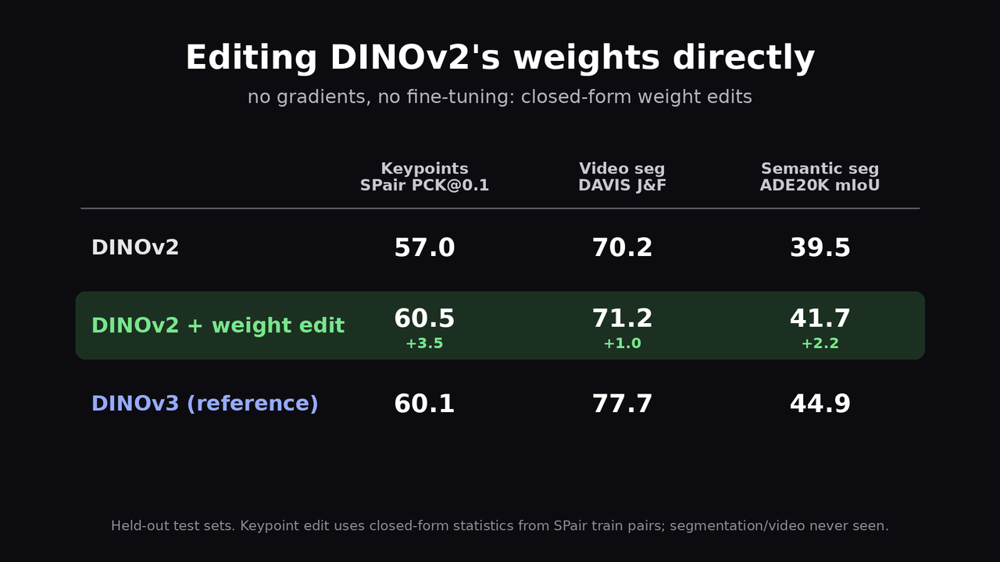
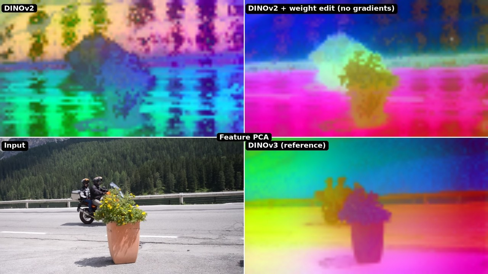

# DINOv2 weight surgery

**Better dense features from DINOv2 ViT-L/14 by editing its weights directly: no gradients, no fine-tuning, no
distillation.** Every changed number was written in closed form.

<p align="center"></p>

| Held-out test sets | DINOv2 ViT-L/14 | **DINOv2 + weight edit** | DINOv3 ViT-L/16 (reference) |
|---|---|---|---|
| Keypoint transfer, SPair-71k PCK@0.1 | 57.0 | **60.5** | 60.1 |
| Video object segmentation, DAVIS-2017 val J&F | 70.2 | **71.2** | 77.7 |
| Semantic segmentation, ADE20K linear probe mIoU | 39.5 | **41.7** | 44.9 |

DINOv3 was never used to choose or fit an edit; it is only a reference row. Read the [caveats](#caveats) before
quoting these numbers.

<p align="center"></p>

## Use the edited model

```python
import torch

model = torch.hub.load("peasant98/dinov2-weight-surgery", "dinov2_vitl14_wsp").cuda()

x = torch.randn(1, 3, 448, 448).cuda()            # ImageNet-normalized, sides are multiples of 14
feats = model.get_intermediate_layers(x, n=1, norm=True)[0]      # (1, 32 * 32, 1024) dense patch features
```

The model is a standard DINOv2 `DinoVisionTransformer` with 25 blocks instead of 24 (one hand-written block is
appended), so it is a drop-in replacement wherever you read DINOv2-L patch features. The weights
(`dinov2_vitl14_wsp.pth`, 1.3 GB, a plain state dict) are attached to the
[GitHub release](https://github.com/peasant98/dinov2-weight-surgery/releases) and download on first use. To load a
local copy: `dinov2_wsp.dinov2_vitl14_wsp(weights="path/to/dinov2_vitl14_wsp.pth")`.

## What was edited

Four edits, applied in this order (`research/build.py` prints the exact chain):

1. **Damp "texture" MLP units.** DINOv2's dense features are speckled, and the speckle is written by MLP units in the
   later blocks. A unit is a texture unit if its activation differs between neighboring patches *inside* one object
   segment almost as much as *across* a segment boundary. Their outputs are pulled toward their mean (kept at 0.5 in
   blocks 7-16 and 0.3 in blocks 17-23). `research/texture_units.py`, `wsp_edits.mean_ablate_texture`.
2. **Switch off the MLP of the last block** (its LayerScale set to 0).
3. **A protected side channel and one appended block.** LayerNorm affines and LayerScales are folded into the
   neighboring linear layers (exact). The 19 channels whose removal costs the least are cut out of every read and
   write, and a Fourier code of the patch position is written into them through the position table. The appended
   block's attention reads only that code, so it is an exact local spatial kernel: each patch is blended with its
   neighbors. `research/side_channel.py`.
4. **A Fisher discriminant written into the appended block's MLP.** From SPair-71k *training* keypoint pairs we
   compute two covariance matrices (matching keypoints vs. all patches) and one generalized eigendecomposition.
   Directions where matching keypoints disagree are shrunk, consistent ones are boosted. Since
   `GELU(z) - GELU(-z) = z`, an MLP can hold an exact linear map, so the result is written straight into `fc1` and
   `fc2`. `research/linmap.py`.

<p align="center"></p>

## How edits were selected

Each round had a rule written down before any result of its candidates was seen (`research/selection_rules/`):
candidates had to match or beat stock DINOv2 on development splits of all three tasks, the pick was the one with the
largest mean development gain, and the test splits in the table were run once for the pick. The raw test outputs are
in `research/results/`.

Things that did **not** work, so you can skip them: attention temperature, damping whole late blocks, attention with
keys in place of queries, stronger or repeated smoothing blocks (prettier feature maps, worse keypoints and video
segmentation), removing the positional subspace, and a Gram-matrix readout of an earlier block.

## Caveats

- **The keypoint gain is not label-free.** Edit 4 uses keypoint annotations of SPair-71k training pairs (60 pairs per
  category), in closed form. The SPair test pairs, DAVIS and ADE20K were never used to fit anything.
- **Only dense patch features were evaluated.** The class token and image-level tasks (k-NN / linear classification)
  were not tested and may be worse.
- **These are our own evaluation protocols, not official benchmark numbers:** zero-shot nearest-neighbor keypoint
  transfer on 1,080 SPair test pairs, label propagation on DAVIS-2017 val, and a linear probe trained on a subset of
  ADE20K. They compare the three backbones under identical settings; they are not comparable to published tables.
- The gains are modest, and DINOv3 remains clearly better on video and semantic segmentation.
- One extra block costs about 4% more compute. Run in fp32 or with bfloat16 autocast; fp16 was not tested.
- ViT-L/14 without registers only.

## Reproduce

`research/` is the code as it was run, lightly cleaned (it is research code, not a library).

```bash
export XFORMERS_DISABLED=1                 # optional, we ran without xformers
export WSP_DATA=/path/to/data              # coco/val2017, benchmarks/spair/SPair-71k, benchmarks/davis/DAVIS,
                                           # benchmarks/ade/ADEChallengeData2016
export WSP_FIT_SCANS=my_images             # folders $WSP_DATA/<name>/images with ~24 natural images (calibration)

python research/build.py                                          # rebuild from stock DINOv2, compare to the release
cd research/downstream
MODELS=stock,wsp python spair.py out_spair.json test_fresh5       # keypoint transfer
MODELS=stock,wsp python davis.py out_davis.json 0 val             # video object segmentation
MODELS=stock,wsp python ade_probe.py out_ade.json fresh3          # semantic segmentation probe (needs ~30 GB RAM)
```

A rebuild matches the released weights closely but not bit for bit: our own rerun with the same calibration images
gave a patch-feature cosine of 0.9998 to the release. Those calibration images were frames of our own video scans and
are not released; any natural images can stand in. The derived statistics that the edits need
(`research/proxy/texunits.pt`, `channel_impact.pt`) are included. The DINOv3 reference rows need the DINOv3 code and
weights (`WSP_DINOV3_REPO`, `WSP_DINOV3_WEIGHTS`). `research/wsp_v3.py` applies the same Fisher edit to DINOv3; its
weights are not redistributed here.

## License and credits

Code and edited weights: Apache-2.0, the license of [DINOv2](https://github.com/facebookresearch/dinov2), from which
the weights are derived. Example images in the figures are from DAVIS-2017 and SPair-71k. The idea of programming
weights by hand follows the "weight-space programming" line of work; see also our
[pi0.5 weight surgery](https://github.com/peasant98/pi05-weight-surgery).
